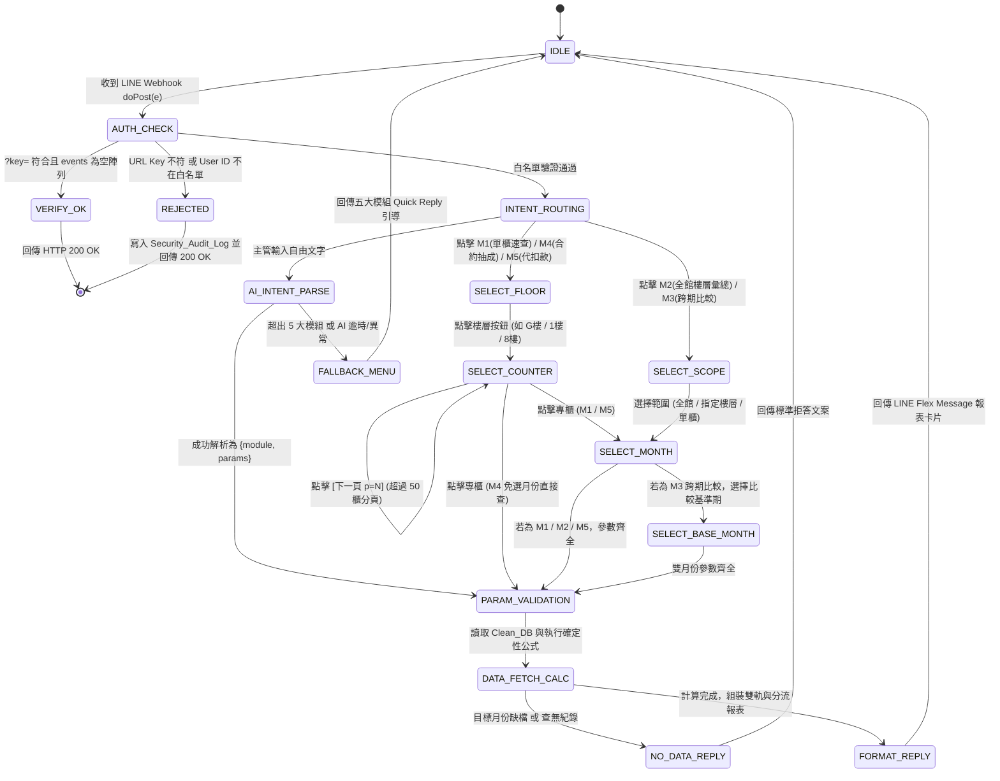

# LINE Bot 商場專櫃營運數據查詢系統 — 軟體設計規格書 (SDD)

> **文件版本**：`v2.0.0 (Audited & Consolidated Final)`  
> **文件狀態**：`Ready for Implementation（已完成技術審理與整合定稿）`  
> **更新日期**：`2026-11-14`  
> **目標平台**：Google Apps Script (GAS / V8 Runtime) + LINE Messaging API + Google Sheets + Gemini API

---

## 一、 技術審理與設計驗證結論 (Technical Audit & Verification)

在整合既有規格並針對 **Google Apps Script (GAS) 執行環境**、**LINE Messaging API 限制**、**Google Drive API** 與 **Gemini API** 進行實作可行性驗證後，確認整體「GAS 零主機費輕量架構 + 確定性公式引擎 + AI 僅負責意圖解析與摘要潤飾」路線完全可行。同時針對實作層面潛在的執行期陷阱，已於本定稿版本完成以下修正與補強：

| 編號 | 審理項目 | 原規格潛在風險 / 缺口 | 本版定稿修正對策 |
| :--- | :--- | :--- | :--- |
| **A-01** | **GAS `doPost(e)` 與 LINE 簽章驗證** | GAS `doPost(e)` 原生物件不提供 HTTP Headers，無法讀取 `x-line-signature`。 | **驗證可行**：採「Webhook URL `?key={WEBHOOK_SECRET_KEY}` 比對 `PropertiesService` ＋ `Auth_Whitelist` 白名單 ＋ Event 結構檢查」。**補強**：收到 LINE Console「Verify」測試請求（`events: []`）時，通過 `?key=` 後須直接回傳 HTTP 200 `"OK"`，避免驗證失敗或 LINE 平台重試。 |
| **A-02** | **GAS `UrlFetchApp` 同步超時限制** | 原規格要求「Gemini API 超過 3.5 秒未回應即中止呼叫並降級」，但 GAS `UrlFetchApp.fetch()` 為同步阻塞且**不支援自訂短 timeout 或中止進行中的請求**。 | **修正機制**：改為「**時間預算檢查（Time-Budget Guard）**」——進入 AI 呼叫前記錄 `startMs`，每次 `429/503` 重試前檢查 `Date.now() - startMs < 2500`；最多重試 1 次（間隔 800ms），逾時預算或失敗即降級回傳快捷選單，確保整體不拖垮 LINE `replyToken`。 |
| **A-03** | **LINE Flex / Quick Reply 硬性上限** | 原規格雖補齊 Bubble 分頁，但遺漏「按鈕標籤字數上限」與「超過 12 樓層」邊界；且實作未見明確的 LINE 訊息輸出範本。 | **補強上限與範本**：Quick Reply 最多 13 顆、每顆 `label` $\le 20$ 字元；Flex Button `label` $\le 40$ 字元；Postback `data` $\le 300$ 字元（中文樓層建議改以短代碼傳遞再查表）；於第 4.4 節補齊 M1～M5 標準輸出排版範本。 |
| **A-04** | **歷史已撤櫃專櫃之樓層歸屬斷層** | `Clean_DB_Contracts` 僅保留 `營運中` 專櫃，若 `M2 / M3` 查詢去年同期（YoY）時遇到「當時營運、現已撤櫃」的專櫃，`Clean_DB_Monthly` 關聯不到樓層會全掉入「未分類樓層」。 | **修正 ETL 關聯邏輯**：ETL 階段先用**全量合約表（含已撤櫃/作廢）＋抽成表＋代扣表**建立完整的 `floor_lookup_map` 來回填 `Clean_DB_Monthly.floor_name`；而 LINE 互動選單則嚴格只讀 `Clean_DB_Contracts`（僅含 `營運中`）。 |
| **A-05** | **Drive API `.xlsx` 轉檔與 `padStart` 空值陷阱** | 新版 GAS 預設啟用 Drive API v3（非 v2 `Files.insert`），轉檔暫存試算表若未刪除會塞爆雲端硬碟；另外 `String(null).padStart(5, '0')` 會變成 `"null0"`。 | **強制防護**：明確規範使用 Drive API v3 `Drive.Files.create` 轉檔並於 `try...finally` 中刪除暫存檔；`normalizeCounterId(val)` 必須先判空（`val === null \|\| val === undefined \|\| String(val).trim() === ''`）才執行 `padStart(5, '0')`。 |
| **A-06** | **Gemini 模型版本與快取效能** | 原規格寫死 `gemini-2.5-flash`，隨模型世代演進有淘汰風險；且每次 Postback 若重讀整張 Google Sheet 易接近 3 秒延遲。 | **可配置化與快取**：模型名稱抽離至 `PropertiesService`（`GEMINI_MODEL`，建議使用當前 Flash 等級模型如 `gemini-3.8-flash`），並透過 `CacheService` 快取樓層/專櫃索引與可用年月（TTL 600 秒），於 ETL 完成後主動清除快取。 |

---

## 二、 系統核心架構與狀態機 (Architecture & State Machine)

### 2.1 元件職責劃分（GAS 零主機費輕量架構）

本系統將耗時的「後台 ERP 報表清洗（ETL）」與前台「LINE 即時查詢（Webhook）」完全解耦，確保主管於手機端操作能在 **1.5 ～ 3 秒內**取得 **100% 確定性計算結果（零 AI 算術幻覺）**。

1. **前端互動層（LINE Official Account / Messaging API）**
   * 以**圖文選單（Rich Menu）**、**快捷按鈕（Quick Reply）**與**分頁卡片（Flex Message Carousel）**提供「純點擊、免打字」操作，自然語言輸入為輔。
   * 所有按鈕皆封裝標準化 Postback Data（Query String 格式），直接驅動後端確定性計算引擎，不消耗 AI Token。
2. **權限與路由守門員（GAS Webhook Gatekeeper）**
   * 接收 `doPost(e)` 事件，依序執行：URL 密鑰驗證（`?key=`） $\rightarrow$ 空白 Verify 事件放行 $\rightarrow$ `Auth_Whitelist` 白名單檢核。
   * 驗證通過後分流：`Postback Event` 直接進入公式引擎；`Message Event`（純文字）交由 AI 意圖解析器轉譯參數。
3. **AI 意圖對號入座與潤飾器（Gemini API, `Temperature: 0.1`）**
   * **意圖解析（Input Parser）**：使用 Structured Output 將主管自由輸入的自然語言轉譯為 5 大模組 ID（`M1`～`M5`）與參數 JSON，**嚴禁 AI 自行計算數字或發明公式**。
   * **摘要潤飾（Output Formatter）**：僅針對公式引擎算出的「確定性數值 JSON 包」生成營運重點摘要；若標記為 `NO_DATA`，強制輸出標準拒答文案。
4. **確定性公式計算引擎（GAS Deterministic Formula Engine）**
   * 100% 由 GAS 原生程式碼執行資料篩選、未稅／含稅雙軌並列、自營櫃 vs. 專櫃（租戶）分流統計、佔比與跨期成長率（MoM／YoY）四則運算，以及 Top 10 降冪排序。
5. **增量 ETL 與中繼資料庫層（Google Sheets `Clean_DB`）**
   * 獨立排程／手動函式 `syncAndCleanErpReports()`，搭配 `LockService` 與 `ETL_Processed_Files` 增量索引，掃描 Google Drive 指定資料夾之 4 類 ERP 匯出檔，清洗後寫入 `Clean_DB`。

---

### 2.2 核心狀態機定義 (State Machine)

系統以 LINE Postback Data 傳遞主要上下文，輔以 `CacheService.getScriptCache()`（Key：`STATE_{userId}`，TTL：600 秒）管理多步驟對話狀態：



| 狀態代碼 | 觸發轉移條件 | 系統執行動作與輸出限制 |
| :--- | :--- | :--- |
| `IDLE` | 初始狀態 | 等待主管點擊圖文選單或輸入文字。 |
| `AUTH_CHECK` | 收到 Webhook | 驗證 `?key=` $\rightarrow$ 若 `events.length === 0` 回傳 200 OK $\rightarrow$ 驗證 `userId` 是否在 `Auth_Whitelist`（`is_active === true`）。 |
| `SELECT_FLOOR` | 觸發 M1 / M4 / M5 | 讀取 `Clean_DB_Contracts` 不重複樓層（依自訂商場樓層順序排序，如 B2, B1, G樓, 1樓...），以 Quick Reply 呈現（上限 13 顆；若超限則改以 Flex Carousel 分頁）。 |
| `SELECT_COUNTER` | `act=sel_fl&fl=X&p=1` | 篩選該樓層所有 `營運中` 專櫃，封裝為 Flex Carousel：**每張 Bubble 最多 10 顆按鈕、每次最多 5 張 Bubble（單頁 50 櫃）**，超過則於最末提供「下一頁 (`p=N+1`)」按鈕。 |
| `SELECT_MONTH` | `act=sel_cid` / `sel_scope` | 讀取 `Clean_DB_Monthly` 已建檔之不重複 `billing_ym`（由新到舊取最新 12 個月），以 Quick Reply 呈現。 |
| `SELECT_BASE_MONTH` | M3 選定 `ym1` 後 | 回傳 Quick Reply 選擇 `ym2`：前 2 顆固定為「上月 (MoM)」、「去年同月 (YoY)」，其餘列出可用月份（合計 $\le 13$ 顆）。 |
| `DATA_FETCH_CALC` | 參數齊全 | 依 `mod` 呼叫對應確定性公式函式，完成後轉交 `FORMAT_REPLY` 或 `NO_DATA_REPLY`。 |

---

## 三、 ETL 清洗規範與資料模型契約 (Data Contract & Schema)

### 3.1 通用 ETL 清洗與轉檔鐵律

1. **Drive API v3 `.xlsx` 轉檔與暫存清理**：
   * 掃描 `RAW_ERP_DRIVE_FOLDER_ID` 資料夾內檔案，比對 `ETL_Processed_Files` 的 `file_id` 與 `modifiedTime`；未異動之歷史檔案直接跳過。
   * 若來源為 `.xlsx`，透過 Drive Advanced Service v3（`Drive.Files.create` 設定 `mimeType: MimeType.GOOGLE_SHEETS`）轉為暫存試算表讀取，並於 **`try ... finally` 區塊中強制呼叫 `Drive.Files.delete(tempFileId)`** 移除暫存檔。
2. **專櫃編號強制標準化（防範前導零流失）**：
   * 實作共用函式 `normalizeCounterId(rawVal)`：若為 `null`、`undefined` 或空白字串回傳 `""`；否則強制執行 `String(rawVal).trim().padStart(5, '0')`（例如數字 `1` 轉為 `"00001"`）。
3. **有效資料列判定（消除雙層表頭與表尾雜訊）**：
   * 僅保留第 1 欄（項次，Column Index `0`）轉為數值後屬於「正整數（$\ge 1$）」且 `counter_id !== ""` 之資料列，自動剔除合併表頭、空白列、表尾「合計 / 列印人員 / 頁碼 1/1」。
4. **跨表樓層回填優先級**：
   * 先以全量合約表（不限營運中）、抽成表、代扣表建立全館專櫃樓層對照表 `floorLookupMap`。
   * 回填優先順序：`合約狀態清單` $\rightarrow$ `專櫃契約抽成報表` $\rightarrow$ `專櫃契約代扣款報表` $\rightarrow$ 預設 `"未分類樓層"`。

---

### 3.2 `Clean_DB` 標準化中繼試算表（6 個分頁 Schema）

#### 分頁 1：`Clean_DB_Contracts`（營運中專櫃主檔與正品抽成彙整）
* **來源**：《合約狀態清單》（表頭 Row Index `3`）、《專櫃契約抽成報表》（表頭 Row Index `3`）、《專櫃契約代扣款報表》（表頭 Row Index `1`）。
* **去重規則**：僅篩選 `租戶狀況 (Col 9) == "營運中"`；同 `counter_id` 若有多筆，依 `合約截止日 (Col 12)` 降冪、再依 `版本編號 (Col 5)` 降冪取最新 1 筆。
* **多品類抽成彙整**：查找《專櫃契約抽成報表》同 `counter_id` 且有效期間涵蓋今日之紀錄，將 `抽成類別名稱 (Col 13)` 與 `正品 (Col 17)` 合併為字串（如 `"(1)寢具: 15% / (2)日韓食品: 12%"`），忽略 90 折～50 折與特價欄位。

| 欄位名稱 | 型別 | 必填 | 預設值 | 0-based 欄位索引與業務規則 |
| :--- | :--- | :---: | :--- | :--- |
| `counter_id` | String | 是 | 無 | 主鍵，5 碼字串（合約表 Col 1） |
| `counter_name` | String | 是 | `"未命名專櫃"` | 合約表 Col 2（空值依抽成表 Col 2 / 代扣表 Col 2 回填） |
| `version_no` | Number | 是 | `1` | 版本編號（合約表 Col 5） |
| `status` | String | 是 | `"營運中"` | 租戶狀況（合約表 Col 9，僅保留 `"營運中"`） |
| `floor_name` | String | 是 | `"未分類樓層"` | 合約表 Col 16 $\rightarrow$ 抽成表 Col 3 $\rightarrow$ 代扣表 Col 5 |
| `area_name` | String | 否 | `""` | 區域名稱（合約表 Col 17 或抽成表 Col 4） |
| `booth_no` | String | 否 | `"未登錄"` | 櫃位編號（合約表 Col 15） |
| `category_name` | String | 否 | `""` | 業種名稱（合約表 Col 6 或抽成表 Col 5） |
| `op_start_date` | String | 是 | 無 | 正式營運起始日 `YYYY-MM-DD`（合約表 Col 13） |
| `op_end_date` | String | 是 | 無 | 正式營運截止日 `YYYY-MM-DD`（合約表 Col 14） |
| `commission_type` | String | 否 | `"一般抽成"` | 抽成別（抽成表 Col 12） |
| `tax_type` | String | 否 | `"應稅"` | 稅別（抽成表 Col 14） |
| `regular_rate_summary` | String | 是 | `"表格未設定正品抽成率"` | 正品抽成率彙整字串（取自抽成表 Col 13 & Col 17） |

#### 分頁 2：`Clean_DB_Monthly`（專櫃月結營收與帳務彙總）
* **來源**：各月份《專櫃結帳彙總表》（雙層表頭 Row Index `3` & `4`，資料列自 Row Index `5` 起）。
* **樓層關聯**：先以 `floorLookupMap[counter_id]` 回填 `floor_name`（確保已撤櫃之歷史資料仍保有正確樓層可供 YoY/MoM 彙總）。

| 欄位名稱 | 型別 | 必填 | 預設值 | 0-based 欄位索引與雙軌計算公式 |
| :--- | :--- | :---: | :--- | :--- |
| `data_source_type` | String | 是 | `"MONTHLY_SETTLEMENT"` | 資料源標籤（預留 `"DAILY_POS"` 擴充） |
| `billing_ym` | String | 是 | 無 | 結帳年月 6 碼字串如 `"202610"`（Col 3） |
| `counter_id` | String | 是 | 無 | 專櫃編號 5 碼字串（Col 1） |
| `counter_name` | String | 是 | 無 | 專櫃名稱（Col 2，空值查 `floorLookupMap` 補齊） |
| `floor_name` | String | 是 | `"未分類樓層"` | 關聯自全量 `floorLookupMap` |
| `coop_mode` | String | 是 | 無 | 租戶配合方式：`"自營櫃"` 或 `"租戶"`（Col 31） |
| `category_name` | 否 | String | `""` | 業種名稱（Col 27） |
| `sales_untaxed` | Number | 是 | `0` | **未稅營收** = `Col 4` (銷貨未稅) + `Col 6` (銷貨免稅) |
| `sales_tax` | Number | 是 | `0` | **銷貨稅額** = `Col 5` |
| `sales_tax_included` | Number | 是 | `0` | **含稅總額** = `Col 4 + Col 5 + Col 6` |
| `comm_untaxed` | Number | 是 | `0` | **抽成未稅** = `Col 7` (抽成未稅) + `Col 9` (抽成免稅) |
| `comm_tax` | Number | 是 | `0` | **抽成稅額** = `Col 8` |
| `comm_total` | Number | 是 | `0` | **抽成額合計** = `Col 10` |
| `purchase_total` | Number | 是 | `0` | 進貨淨額合計 = `Col 14` |
| `ar_deduction_untaxed` | Number | 是 | `0` | 代扣款未稅合計 = `Col 15` (開立未稅) + `Col 17` (不開立免稅) |
| `ar_deduction_tax` | Number | 是 | `0` | 代扣款稅額 = `Col 16` |
| `ar_rent_untaxed` | Number | 是 | `0` | 租金未稅 = `Col 18` |
| `ar_rent_tax` | Number | 是 | `0` | 租金稅額 = `Col 19` |
| `ar_total` | Number | 是 | `0` | 應收帳款合計 = `Col 20` |
| `min_guarantee_short` | Number | 是 | `0` | 包底抽成不足(含稅) = `Col 21` |
| `ap_total_tax_inc` | Number | 是 | `0` | 應付帳款(含稅) = `Col 22` |
| `expected_pay_date` | String | 否 | `""` | 預計付款日 `YYYY-MM-DD`（Col 23） |
| `billing_batch` | Number | 是 | `1` | 結帳帳次（Col 28） |
| `is_duplicate_anomaly` | Boolean | 是 | `false` | 同 `billing_ym + counter_id` 出現 $\ge 2$ 筆則標記 `true` |

#### 分頁 3：`Clean_DB_Deductions`（專櫃契約代扣款明細）
* **來源**：《專櫃契約代扣款報表》（表頭 Row Index `1`，資料列自 Row Index `2` 起；含水平合併儲存格，採固定欄位索引）。

| 欄位名稱 | 型別 | 必填 | 預設值 | 0-based 欄位索引與業務規則 |
| :--- | :--- | :---: | :--- | :--- |
| `counter_id` | String | 是 | 無 | 專櫃編號（Col 1） |
| `deduct_category` | String | 是 | 無 | 扣款類別：`"一次扣款"` 或 `"每月扣款"`（Col 18） |
| `deduct_item_name` | String | 是 | 無 | 扣款項目名稱，如 `"(B02) 管理費"`（Col 19） |
| `start_ym` | String | 是 | 無 | 起始月份 `YYYYMM`（Col 20） |
| `end_ym` | String | 是 | 無 | 結束月份 `YYYYMM`（Col 21） |
| `amount_untaxed` | Number | 否 | `null` | 扣款金額(未稅)（Col 22，空白存 `null`） |
| `down_payment` | Number | 否 | `null` | 頭期款（Col 24） |
| `monthly_amount` | Number | 否 | `null` | 每月金額（Col 25） |
| `installment_periods` | Number | 否 | `null` | 分攤期數（Col 26） |
| `total_amount` | Number | 否 | `null` | 總金額（Col 27） |

#### 分頁 4：`Clean_DB_DailyPOS`（未來每日營業額擴充預留表）
* 欄位：`data_source_type` (`"DAILY_POS"`), `pos_date` (`YYYY-MM-DD`), `counter_id`, `coop_mode`, `sales_untaxed`, `sales_tax_included`, `tx_count`。

#### 分頁 5：`ETL_Processed_Files`（增量同步索引）
* 欄位：`file_id`, `file_name`, `report_type`, `billing_ym`, `last_modified_time`, `synced_at`。

#### 分頁 6：`Auth_Whitelist` & `Security_Audit_Log`（權限與稽核）
* `Auth_Whitelist`：`line_user_id`, `manager_name`, `department`, `is_active` (Boolean), `created_at`。
* `Security_Audit_Log`：`timestamp`, `line_user_id`, `event_type`, `raw_payload`, `reject_reason`。

---

## 四、 內部 API 契約與五大確定性公式模組

### 4.1 LINE Postback Data 參數契約
所有按鈕採用標準 Query String，**嚴格控制在 300 字元內**：
`mod={M1..M5}&act={StepName}&fl={FloorCode}&cid={CounterID}&ym1={TargetYM}&ym2={BaseYM}&scope={ALL|FLOOR|COUNTER}&comb={0|1}&p={PageNo}`

* **按鈕字數限制**：Quick Reply `label` $\le 20$ 字元；Flex Button `label` $\le 40$ 字元；超過應截斷並加 `...`。

### 4.2 AI 自然語言意圖轉譯 Schema（Gemini Structured Output）
呼叫 `https://generativelanguage.googleapis.com/v1beta/models/${GEMINI_MODEL}:generateContent`，設定 `responseMimeType: "application/json"` 與 `temperature: 0.1`、`maxOutputTokens: 512`，嚴格回傳以下結構：

```json
{
  "is_supported": true,
  "module_id": "M1 | M2 | M3 | M4 | M5 | UNSUPPORTED",
  "scope": "COUNTER | FLOOR | ALL_STORE",
  "floor_name": "G樓 | 1樓 | 8樓 | null",
  "counter_keyword": "專櫃名稱或編號關鍵字 | null",
  "target_ym": "YYYYMM | null",
  "base_ym": "YYYYMM | null",
  "include_combined_view": false
}
```

### 4.3 五大固定公式模組確定性計算契約

1. **模組 M1：【單一專櫃】月度營收與帳務速查**（輸入：`counter_id`, `target_ym`）
   * **銷貨淨額（雙軌）**：未稅 `sales_untaxed` ／ 含稅 `sales_tax_included`（附註稅額 `sales_tax`）。
   * **商場抽成額合計**：`comm_total`（未稅 `comm_untaxed` + 稅額 `comm_tax`）。
   * **實際綜合抽成率 (%)**：
     * 若 `sales_untaxed > 0`：計算 `ROUND((comm_total / sales_untaxed) * 100, 2)`（對未稅比）與 `ROUND((comm_total / sales_tax_included) * 100, 2)`（對含稅比）。
     * 若 `sales_untaxed == 0`：顯示 `"0.00% (當月銷貨為 0)"`。
   * **應收帳款**：`ar_total`（細列 `ar_deduction_untaxed`、租金未稅 `ar_rent_untaxed`、稅額合計）。
   * **包底抽成不足(含稅)**：`min_guarantee_short`；**應付帳款(含稅)**：`ap_total_tax_inc`；**預計付款日**：`expected_pay_date`。

2. **模組 M2：【全館 / 樓層彙總】與 Top 10 排行榜**（輸入：`scope`, `target_ym`, `comb` = `0|1`）
   * **預設分流統計**：獨立計算並呈現 **【自營櫃區塊 (`coop_mode == "自營櫃"`)】** 與 **【專櫃(租戶)區塊 (`coop_mode == "租戶"`)】** 之家數、$\sum \text{sales\_untaxed}$、$\sum \text{sales\_tax\_included}$、$\sum \text{comm\_total}$（專櫃另附 $\sum \text{ar\_total}$）。
   * **Top 10 排行榜**：各群組依 `sales_untaxed` 降冪取前 10 名（不足 10 櫃則全列），顯示排名、專櫃名稱、未稅/含稅金額與佔該群組總營收百分比。
   * **選擇性合併視角**：僅當 `comb=1`（或點選「加看全店合併」）時，於底部附加全店總計與全店綜合 Top 10。

3. **模組 M3：【跨期營收比較（MoM / YoY）】與三線成長曲線對比**（輸入：`scope`, `target_ym`, `base_ym`）
   * **缺檔攔截**：任一月份不在 `Clean_DB_Monthly` 立即回傳 `ERR_MISSING_MONTH`。
   * **單一指標成長公式**：差額 $\text{Diff} = V_{\text{curr}} - V_{\text{base}}$；成長率 $= V_{\text{base}} > 0 \text{ ? } \text{ROUND}((V_{\text{curr}} - V_{\text{base}}) / V_{\text{base}} \times 100, 2) : \text{"N/A"}$。
   * **強制三線並陳**：均包含「未稅營收」、「含稅總額」、「抽成額合計」三項指標：
     1. 📊 **第一線：自營櫃總計 (`SELF_OPERATED`)**
     2. 🛍️ **第二線：專櫃(租戶)總計 (`TENANT_COUNTER`)**
     3. 🏢 **第三線：全店合併總計 (`ALL_COMBINED`)**（含自營 vs. 專櫃佔比結構位移 `ppt` 變化）
   * 若 `scope == "COUNTER"`，第一區塊顯示該單櫃自身跨期表現，第二區塊緊接著並列上述三條大盤曲線對照。

4. **模組 M4：【合約效期與正品抽成條件】查詢**（輸入：`counter_id` 或 `act=expiring_soon`）
   * 顯示專櫃基本資料、`op_start_date ～ op_end_date`、`commission_type`、`tax_type`、`regular_rate_summary`。
   * **到期預警**：$\text{剩餘天數} = \lfloor (\text{op\_end\_date} - \text{今日}) / 86400000 \rfloor$。$0 \le \text{剩餘天數} \le 90$ 標示 `⚠️ 合約將於 X 天後到期`；$< 0$ 標示 `🚨 合約已逾期 X 天（請確認續約狀態）`。

5. **模組 M5：【專櫃代扣款】明細檢核**（輸入：`counter_id`, `target_ym`）
   * 篩選 `Clean_DB_Deductions` 中 `counter_id` 相符且 `Number(start_ym) <= Number(target_ym) && Number(target_ym) <= Number(end_ym)` 之紀錄。
   * 逐筆列出扣款類別、項目名稱、未稅金額、每月金額、分攤期數（欄位為 `null` 顯示 `"表格無填寫金額"`），並於底部並列 `Clean_DB_Monthly.ar_deduction_untaxed` 供交叉核對。

### 4.4 LINE Flex Message 標準輸出排版範本（M1～M5）

* **M1 單櫃月報卡片結構**：Header 標示 `[YYYYMM] [counter_id] [counter_name] ([floor_name] · [coop_mode])` $\rightarrow$ Body 分為「營收與抽成（未稅 / 含稅 / 抽成額 / 綜合抽成率）」、「帳務結算（應收合計與細項 / 包底不足 / 應付含稅 / 預計付款日）」 $\rightarrow$ Footer 附快捷按鈕（`查合約 M4`、`查代扣 M5`、`跨期比較 M3`）。
* **M2 彙總卡片結構**：Bubble 1 為自營櫃彙總 + 自營 Top 10；Bubble 2 為專櫃(租戶)彙總 + 租戶 Top 10；Footer 提供「加看全店合併 (`comb=1`)」按鈕。
* **M3 三線比較卡片結構**：若為單櫃先列「📍 單櫃表現」，接續以清晰分隔線並列「📊 自營總計 / 🛍️ 專櫃總計 / 🏢 全店合併」三組金額差額與 `%` 漲跌幅。
* **M4 / M5 卡片結構**：條列合約/扣款明細與狀態徽章（`⚠️` / `🚨`），底部保留切換同櫃其他模組按鈕。

---

## 五、 安全邊界與例外降級機制 (Security & Resilience)

### 5.1 雙重應用層驗證與去敏規範
1. **第一道防線（URL Secret Key）**：Webhook URL 設為 `https://script.google.com/macros/s/{DEPLOYMENT_ID}/exec?key={WEBHOOK_SECRET_KEY}`，比對不符立即丟棄並回傳 200 OK（防止重試）。
2. **第二道防線（`Auth_Whitelist`）**：比對 `event.source.userId`（支援 `CacheService` 5 分鐘快取），未授權者寫入 `Security_Audit_Log` 並回傳固定阻擋訊息與其 `userId` 供管理員開通。
3. **憑證管理鐵律**：程式碼嚴禁硬編碼任何金鑰與試算表 ID，統一置於 `PropertiesService.getScriptProperties()`：
   * `WEBHOOK_SECRET_KEY`
   * `LINE_CHANNEL_ACCESS_TOKEN`
   * `GEMINI_API_KEY`
   * `GEMINI_MODEL`（例：`gemini-3.8-flash`）
   * `CLEAN_DB_SPREADSHEET_ID`
   * `RAW_ERP_DRIVE_FOLDER_ID`

### 5.2 例外代碼與防呆對策（零幻覺防線）

| 異常代碼 | 觸發條件 | 系統強制處置 |
| :--- | :--- | :--- |
| `ERR_MISSING_MONTH` | 查詢月份未匯入 `Clean_DB_Monthly` | 回傳：「📭 查無 `[YYYYMM]` 數據。目前系統已建檔月份為：`[列出可用年月]`。」 |
| `ERR_NO_COUNTER_RECORD` | 營運中專櫃於該月結帳表無資料列 | 回傳：「📭 `[專櫃編號 名稱]` 於 `[YYYYMM]` 無任何帳務紀錄，無法計算。」（嚴禁補 0） |
| `ERR_DIVIDE_BY_ZERO` | 成長率基準期為 0 或銷貨淨額為 0 | 強制攔截回傳 `"N/A (基準期/分母為 0)"`，絕不輸出 `NaN` / `Infinity`。 |
| `ERR_DUPLICATE_BATCH` | 同櫃同月出現 $\ge 2$ 筆資料列 | 頂部醒目提示「⚠️ 帳務異常預警：本月出現 X 筆紀錄」，並列明各筆。 |
| `ERR_NULL_FIELD` | 原表數值欄位為空白 `null` | 明確顯示「表格無紀錄」，不自動補 0。 |

### 5.3 併發保護、快取與 AI 降級
* **ETL 併發鎖**：`syncAndCleanErpReports()` 執行前呼叫 `LockService.getScriptLock().tryLock(5000)`，結束後清除 `CacheService` 索引快取。
* **AI 時間預算與降級**：Gemini API 僅於自然語言查詢時呼叫；設定時間預算 `2,500ms`（發生 `429/503` 且尚在預算內才 sleep 800ms 重試 1 次），超時或失敗立即降級回傳五大模組 Quick Reply。

---

## 六、 建議專案結構與分階段驗收標準 (DoD)

### 6.1 GAS / `clasp` 專案目錄結構
```text
line-bot-counter-analytics/
├── .gitignore                 # 隔離 .clasp.json, .env, credentials.json
├── .clasp.json.sample         # clasp 部署設定範本（不含真實 scriptId）
├── env.properties.sample      # ScriptProperties 設定鍵值範本
├── README.md                  # 專案說明與部署指令
├── SDD_設計規格書.md           # 本規格書
└── src/                       # GAS 原始碼 (後續開發階段建立)
    ├── appsscript.json        # 啟用 Drive v3 Advanced Service 與 V8 Runtime
    ├── Config.gs              # 讀取 PropertiesService 與常數定義
    ├── Security.gs            # ?key= 驗證、Auth_Whitelist 與 Audit Log
    ├── EtlSync.gs             # 增量 ETL、Drive v3 轉檔與四表清洗
    ├── FormulaEngine.gs       # M1～M5 確定性公式計算引擎
    ├── GeminiClient.gs        # 意圖解析 (Structured Output) 與摘要潤飾
    ├── LineFlexBuilder.gs     # Quick Reply、分頁 Carousel 與 M1～M5 卡片模板
    └── Main.gs                # doPost(e) 入口、狀態機與路由分發
```

### 6.2 驗收標準清單 (Acceptance Criteria)
- [ ] **ETL 清洗與前導零保護**：`Clean_DB` 無殘留表頭/表尾雜訊，專櫃編號完整保留 5 碼前導零字串；暫存轉檔試算表於 `finally` 清除完畢。
- [ ] **三表樓層回填與歷史一致性**：空白樓層正確從抽成/代扣表回填；已撤櫃歷史月份資料於 M2/M3 仍保有正確樓層歸屬。
- [ ] **純點擊分頁**：單一樓層超過 12 櫃時正確分頁顯示（單頁最多 50 櫃），無 LINE 400 錯誤，Quick Reply / Flex Button 字數符合上限。
- [ ] **雙軌口徑與三線並陳**：M1～M3 同時並列未稅與含稅金額；M2 預設自營與專櫃分流；M3 強制並列自營/專櫃/全店三線對比；M4 正確顯示多品類正品抽成率與 90 天到期預警。
- [ ] **資安與零幻覺**：無 `?key=` 或未在白名單之帳號 100% 攔截寫入 Log；LINE Verify 空事件回傳 200 OK；缺檔/除零/空值 100% 觸發標準拒答。
- [ ] **效能指標**：Postback 按鈕查詢 $\le 3$ 秒；自然語言文字查詢 $\le 6$ 秒；四則運算誤差率 0%。
